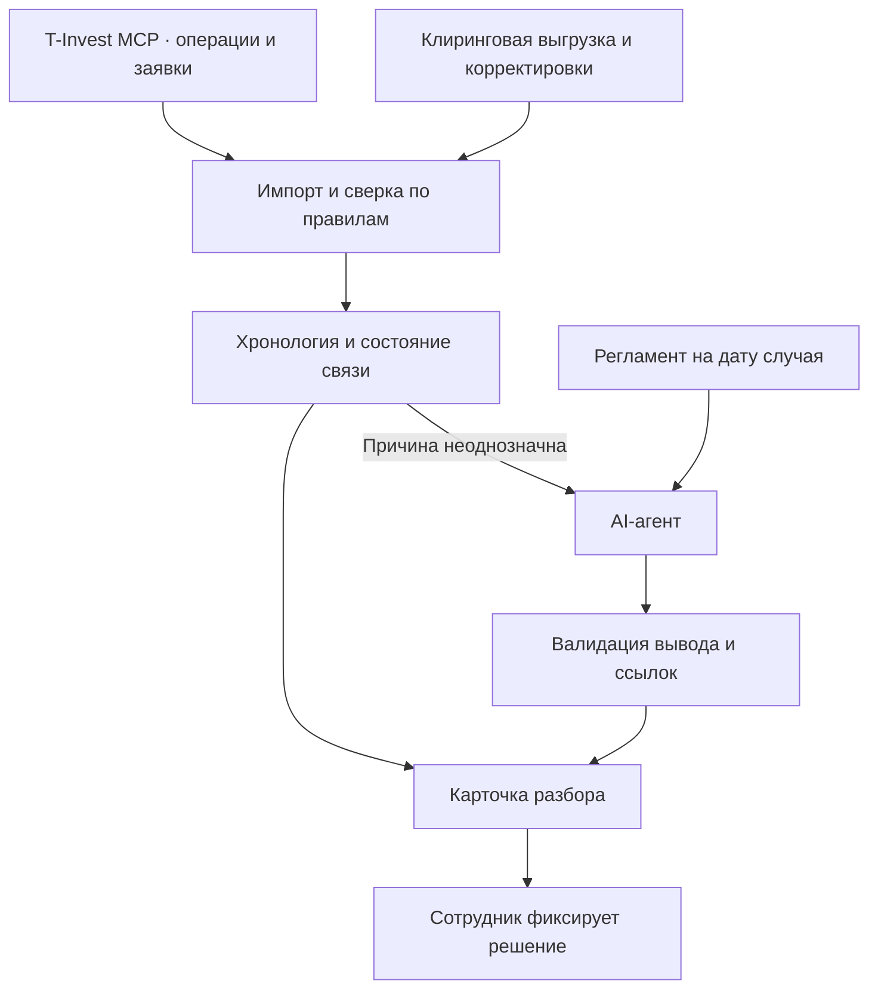

# MVP · AI-агент для разбора расхождений по сделкам

**Пользователь:** сотрудник бэк-офиса брокера, разбирающий исключения после автоматической сверки. **Результат:** карточка с хронологией, возможной причиной, подтверждающими записями и следующим шагом. Сотрудник фиксирует решение, включая запрос недостающей записи или передачу случая на исправление.

## 1. Основания и границы

- Т-Банк документирует, что идентификатор операции может меняться, а идентификаторы сделок в операциях и заявках иногда расходятся. Документация предлагает передавать ID операции в `GetOrderState` как `order_id`. Проверим этот путь на данных MCP. Прямое равенство `tradesInfo.trades[].num` и `stages[].tradeId` пока не подтверждено. [Особенности сервиса операций](https://developer.tbank.ru/invest/services/operations/operations_problems), [схема GetOrderState](https://developer.tbank.ru/invest/api/orders-service-get-order-state).
- НКЦ публикует описания клиринговых отчётов, включая EQM06 и EQM05. Применимый отчёт, правила выгрузки и доступ к строкам конкретного случая нужно согласовать с брокером. [Каталог НКЦ](https://www.nationalclearingcentre.ru/catalog/0205).
- Полевое исследование Brynjolfsson, Li и Raymond изучает помощь генеративного ИИ сотрудникам поддержки и показывает, что эффект может различаться между сотрудниками. Это основание для измерения времени и качества в нашем процессе. Частота исключений у брокера и величина эффекта для бэк-офиса пока неизвестны. [Generative AI at Work](https://www.nber.org/papers/w31161).

**Первый сценарий** — в заявке есть исполнение, а соответствующая запись операции или клиринга отсутствует либо не сходится по количеству на момент разбора. Включаем частичное исполнение, задержку выгрузки, корректировку и недостаток данных. Для демонстрации используем синтетические записи. Для пилота нужны обезличенные реальные случаи и специалист предметной области.

## 2. Что потребуется

| Источник | Минимум данных | Что проверяем |
| --- | --- | --- |
| T-Invest MCP, чтение | Псевдоним счёта, инструмент, сторона, времена, количество, ID операции, ID заявки и исполнения, если доступны | Пагинация, частичные исполнения, изменение ID, документированный путь получения состояния заявки |
| Клиринговая выгрузка брокера | Идентификаторы строк, инструмент, количество, дата расчётов и время доступности | Связь с исполнением и возможность восстановить состояние на момент разбора |
| Журнал корректировок | Время, ссылка на исходную запись, описание или код причины | Какие комментарии и корректировки сотрудник действительно видел |
| Регламент и архив разборов | Версия регламента, сроки, допустимые действия, отдельно зафиксированный исход | Применимость правила на дату случая и независимая оценка результата |

Брокер предоставляет согласованные обезличенные выгрузки. Токен хранится вне репозитория. В публичном репозитории допускаются синтетические примеры. В модель передаются минимально необходимые поля. Для пилота отдельно согласуем среду обработки и срок хранения.

## 3. Технический контур

Первый запуск — один сервис и веб-карточка, которая читает синтетические JSON-файлы. Результат разбора можно сохранить как JSON. Для пилота используем PostgreSQL, когда потребуется хранить историю импортов и решения нескольких сотрудников. Храним входные записи с происхождением, версии регламента и решения. Повторную загрузку записи предотвращает уникальный ключ из источника, идентификатора строки и версии выгрузки. Импорт одной выгрузки выполняем транзакцией.

Агент получает хронологию, комментарии и фрагменты регламента, отобранные по типу и дате случая. Возвращает структурированный результат с возможной причиной, ссылками на факты и предлагаемым действием. Если подтверждения не хватает, указывает конкретную запись для запроса. Сервис проверяет схему ответа и наличие ссылок во входных данных. При ошибке модели карточка остаётся доступной с результатом сверки. В журнале сохраняем использованные версии источников и решение сотрудника.

## 4. Контракт первого демо

Один JSON-файл на случай. Верхний уровень содержит `case_id`, `as_of`, массив `records` и ссылки на пункты демонстрационного регламента. Каждая запись содержит `source`, `record_id`, `event_at` и `available_at` в UTC. Для исполнения, операции и клиринга нужны инструмент, сторона и количество в штуках. В демо `execution_ref` задаёт явную связь с исполнением. Для реальной выгрузки способ получения этой связи проверяем отдельно. Запись о корректировке содержит ссылку на исходную строку и комментарий. Исправленное количество учитываем после появления подтверждающей записи.

- В карточку попадают записи с `available_at <= as_of`. Суммируем исполнения и сравниваем итог с операцией и клирингом. Подтверждённая исправленная строка заменяет исходное значение после того, как стала доступна. Если связь отсутствует или неоднозначна, код сохраняет неопределённость.
- Выход сверки содержит `status` (`matched`, `mismatch` или `unresolved`), количества по источникам и хронологию. Подсказка ИИ содержит `reason`, `evidence_refs` и `next_action`. Ссылка включает источник и ID записи либо версию и пункт регламента.
- На демо проверяем результат от загрузки файла до решения сотрудника. Ниже ожидаемые результаты контрольных примеров.

| Пример | Ожидаемый результат |
| --- | --- |
| Два исполнения на 40 и 60 штук, операция и клиринг на 100 | `matched`. Карточка показывает оба исполнения и итог 100. |
| Исполнение и операция на 100, клиринговая строка появляется после `as_of` | `unresolved`. Карточка показывает, что клиринговой строки на момент разбора нет. Следующий шаг — проверить выгрузку по сроку из регламента. |
| Исполнение и операция на 100, клиринг на 90, в комментарии к корректировке объяснена разница, но новой строки ещё нет | `mismatch`. Подсказка ссылается на клиринговую строку и комментарий, предлагает проверить исправленную выгрузку. Сверка продолжает показывать 10 штук расхождения. |
| Модель недоступна или вернула неизвестную ссылку | Карточка сохраняет статус и хронологию сверки. Непроверенная подсказка скрыта. |

Сначала принимаем демо на файлах. Затем проверяем доступность реальных связок и только после этого проводим эксперимент с сотрудниками.

## 5. Этапы и критерии приёмки

| Этап | Результат | Критерий приёмки |
| --- | --- | --- |
| 1. Проверить данные | Матрица полей и обезличенная серия примеров | Выполнен протокол проверки данных из раздела 6. |
| 2. Собрать карточку без ИИ | Импорт, правила, хронология и фиксация решения | На контрольных примерах повторный импорт не создаёт дублей, частичные исполнения суммируются, неполные и неоднозначные связи отмечаются. Результат сверки воспроизводится из сохранённых входов. |
| 3. Добавить подсказку ИИ | Объяснение со ссылками и следующим шагом | Каждая показанная ссылка ведёт к переданной записи. На контрольном примере с неполными данными агент запрашивает источник. При ошибке модели или ссылки остаётся рабочая карточка без подсказки. |
| 4. Провести пилот | Отчёт о времени, ошибках и объёме ручной работы | В отчёте указаны выборка, результаты обеих групп, доверительные интервалы и решение о продолжении. Демо на синтетике принимается отдельно от пилота. |

## 6. Как проверим пользу ИИ

**Проверка данных.** На серии реальных обезличенных случаев проверяем связку заявки, операции и клиринговой записи, в том числе при частичном исполнении, задержках и неполных данных. Эксперт независимо размечает допустимые связи. До пилота согласуем минимальную приемлемую долю случаев с достаточными данными, исходя из объёма ручной работы. Если связки недоступны, показываем техническое демо на синтетике и фиксируем зависимость от брокера.

**Эксперимент с пользователями.** На отдельной выборке закрытых случаев сравниваем одинаковые карточки со сверкой и хронологией. Одна группа получает подсказку ИИ. Варианты распределяем случайно с балансом по типу случая. Один сотрудник видит каждый случай максимум один раз. Из входа исключаем сведения, появившиеся после момента принятия решения. Независимый специалист заранее фиксирует допустимые действия, оценщик не знает, в какой группе был сотрудник.

**Решение о пилоте.** Цель — на 20% меньше медианное время до верного действия без практически значимого роста доли неверных решений. Допустимую границу для ошибок задаём с владельцем процесса до основного теста. По пробному прогону оцениваем разброс времени и частоту ошибок для расчёта размера выборки. В отчёте показываем доверительные интервалы по обеим метрикам и долю случаев без верного решения за отведённое время. При недостаточной точности результат остаётся предварительным.

Для оценки экономии нужны число подходящих случаев за месяц и фактическое время ручного разбора. При достаточных данных сравним суммарные трудозатраты с учётом ручной проверки подсказок.
